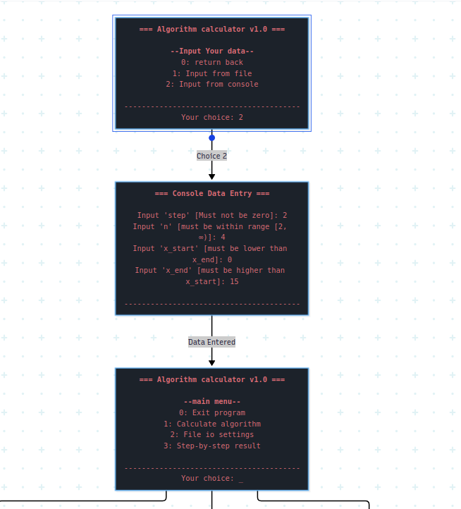
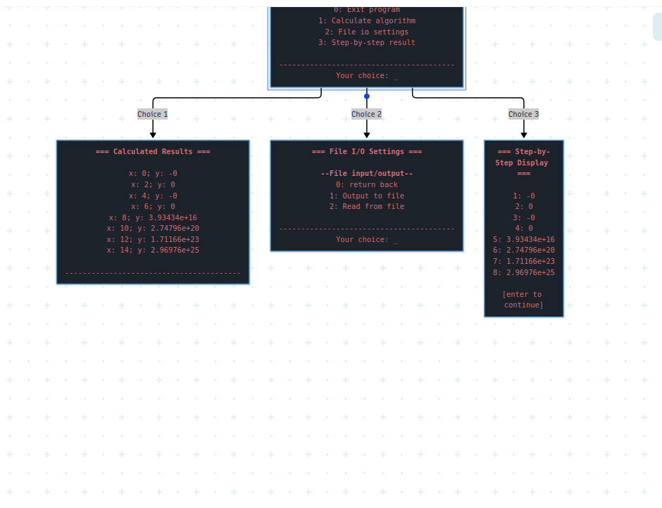

```text
                    MINISTRY OF EDUCATION AND SCIENCE OF UKRAINE
                    NATIONAL TECHNICAL UNIVERSITY
                    “KHARKIV POLYTECHNIC INSTITUTE”
          DEPARTMENT OF SOFTWARE ENGINEERING AND MANAGEMENT
                    INFORMATION TECHNOLOGIES


                         Report of laboratory work № 2
                         Discipline «Software Engineering»
                         Theme: Coding of Domain


                         Executed by:
                         Student of group KN-226e
                         Budkov O. Yu.

                         Checked by:
                         Associate professor
                         Melnyk K. V.


                         Kharkiv
                         2026
```

<div style="page-break-after: always;"></div>

Goal: learning basic principles of C++.

Task (Variant 3): the program reads the integer range `x_start…x_end`, the integer step `dx`, and the integer `n`. It calculates the value of the assigned function at each `x` in the range:

```text
y = sum(i = 1…n) ((x + i)^2) + 5x,                              if x < 0;
y = product(i = 0…n) product(j = 1…n−1) (i + x^2/(i + j) − 3j), if x >= 0.
```

The expression above is written to match the loop bounds in the C++ source: the outer loop includes `i = n`, and the inner loop stops at `j = n - 1`.

## Task 2.1 Program for the Task from the Previous Lab

The program is divided into four source modules. `main.cpp` starts the interface, `interface.cpp` reads input and manages the menus and files, `algorithm.cpp` validates the calculation parameters and evaluates the formula, and `global.cpp` stores the shared parameters and results. The input file contains four integers in this order: `x_start x_end step n`.

The calculation of `y` is implemented in `src/algorithm.cpp`:

**Figure 1.1 – Calculation of y over the range**

```cpp
auto calculate(int x_start, int x_end, int step, int n) -> std::vector<double> {
    auto x = x_start;
    std::vector<double> results;
    while ((step > 0 && x <= x_end) || (step < 0 && x >= x_end)) {
        double y = x >= 0 ? 1.0 : 0.0;
        if (x >= 0) {
            for (int i = 0; i <= n; ++i) {
                double y_j = 1;
                for (int j = 1; j < n; ++j) {
                    y_j *= i + (std::pow(x, 2) / (i + j)) - 3*j;
                }
                y *= y_j;
            }
        } else {
            for (int i = 1; i <= n; ++i) {
                const double term = static_cast<double>(x) + i;
                y += term * term;
            }
            y += 5.0 * x;
        }
        std::cout << "x: " << x << "; y: " << y << '\n';
        results.push_back(y);
        if ((step > 0 && x > std::numeric_limits<int>::max() - step) ||
            (step < 0 && x < std::numeric_limits<int>::min() - step)) break;
        x += step;
    }
    return results;
}
```

For negative `x`, the program sums the squared terms and adds `5x`. For nonnegative `x`, it calculates the nested products. It prints and stores the result for each value of `x`. The range ends when the next value would pass `x_end`; the integer-bound check prevents overflow when adding the step.

The input routine in `algorithm.cpp` reads the step, `n`, and range endpoints. It rejects a zero step and `n` values below 2. If the sign of the step does not lead from `x_start` toward `x_end`, the user may replace one of those three values.

**Figure 1.2 – Validation of entered parameters**

```cpp
if (step == null || step == 0) {
    gather_v("step", step, "Must not be zero");
} else if (n == null || n < 2) {
    gather_v("n", n, "must be within range [2, ∞)");
} else if (x_start == null && x_end == null) {
    gather_v("x_start", x_start, "must be lower than x_end");
    gather_v("x_end", x_end, "must be higher than x_start");
} else if ((step > 0 && x_start > x_end) ||
           (step < 0 && x_start < x_end)) {
    std::cout << "incorrect combination of x_start, x_end and step.\n";
    output_candidate_for_input("x_start", "must be lower than x_end", true);
    output_candidate_for_input("x_end", "must be higher than x_start", true);
    output_candidate_for_input("step", "must not be zero", true);
    std::cout << "Your input: ";
    parse_into_candidate(
        std::make_tuple("x_start", "x_end", "step"),
        std::tie(x_start, x_end, step));
}
```

`gather_v()` parses a complete integer line with `std::from_chars`. If parsing fails, it asks for the value again:

**Figure 1.3 – Integer input parsing**

```cpp
const auto [ptr, ec] = std::from_chars(begin, end, parsed);
if (ec == std::errc{} && ptr == end) {
    v = parsed;
    return;
}
std::cout << "Invalid integer; try again.\n";
```

When parameters are loaded from a file, `read_input_file()` requires four integers, checks the step direction and `n`, and rejects additional values before saving the parameters in the shared state:

**Figure 1.4 – Reading and checking parameters from a file**

```cpp
if (!(ifs >> x_start >> x_end >> step >> n)) {
    std::cout << "Invalid file format. Expected: x_start x_end step n\n";
    return false;
}
if (step == 0 ||
    (step > 0 && x_start > x_end) ||
    (step < 0 && x_start < x_end) || n < 2) {
    std::cout << "Invalid parameter values\n";
    return false;
}
std::string extra;
if (ifs >> extra) {
    std::cout << "Too many values in input file\n";
    return false;
}

global::x_start = x_start;
global::x_end = x_end;
global::step = step;
global::n = n;
return true;
```

The `enter()` function controls the main menu. Option 1 calculates the function, option 2 writes the last calculated result to a file, option 3 displays the stored values, and option 0 exits. After calculation, the last value is stored for output to a file.

**Figure 1.5 – Main-menu actions**

```cpp
switch (choice) {
    case 0:
        return;
    case 1:
        global::results = calculate(global::x_start, global::x_end,
                                    global::step, global::n);
        global::calc_result = global::results.empty()
            ? std::nan("") : global::results.back();
        std::cout << "Calculated!" << std::endl;
        break;
    case 2:
        if (param.empty()) {
            std::cout << "Enter output file path: ";
            std::getline(std::cin, param);
        }
        if (param.empty()) {
            std::cout << "File path must not be empty\n";
            wait();
            break;
        }
        output_to_file(param.c_str());
        break;
    case 3:
        for (std::size_t i = 0; i < global::results.size(); ++i)
            std::cout << i + 1 << ": " << global::results[i] << std::endl;
        wait();
        break;
}
```

**Figure 1.6 – Main function**

```cpp
int main(int argc, char **argv) {
    enter();
    return 0;
}
```

The program wireframes are stored in `wf/enter.puml` and `wf/calc.puml`. Figure 1.2 shows the entry and main-menu flow. Figure 1.3 shows the calculation sequence and display of values.



*Figure 1.2 – Wireframe: input and main menu*



*Figure 1.3 – Wireframe: calculation and results*

## Task 2.2 Enhancing Interface and User Experience. Wireframe

The console program displays a framed menu and asks for a numbered choice. The first screen offers input from a file or from the console. The main menu allows the user to calculate, output the last calculated value to a file, display stored results, or exit. Selecting “Output to file” saves the result directly, using a filename supplied with the menu choice or requested by a prompt.

The input prompt identifies the required parameter. Integer parsing rejects extra characters and non-integer values. File input checks for missing, invalid, or extra values. The program reports errors and pauses for Enter after file operations and result display.

Use Case 1: Input data from the console. The user selects “Input from console” and enters `step`, `n`, `x_start`, and `x_end`. If `step` is zero or its direction does not match the interval, the program requests a corrected value.

Use Case 2: Read data from a file. The user selects “Input from file” and provides a path. The file contains `x_start x_end step n`. If the values are valid, the program loads them for calculation.

Use Case 3: Calculate the function. The user selects “Calculate algorithm.” The program computes `y` for each `x` in the range, displays each pair, and stores the results.

Use Case 4: View calculation results. The user selects “Step-by-step result.” The program displays the stored result values in order.

Use Case 5: Save a result. The user selects “Output to file” from the main menu. The program writes the last calculated result to the specified file. If no calculation has been made, it reports that the result must be calculated first.

Use Case 6: Exit. The user selects `0` from the main menu.

## Conclusions

During this laboratory work we learned the basic principles of C++ by implementing a console program for the assigned function. The program calculates values across a specified range, validates parameters from the console or a file, stores and displays the results, and supports file input and output. We also prepared wireframes for the program's input, menu, calculation, and result screens.
